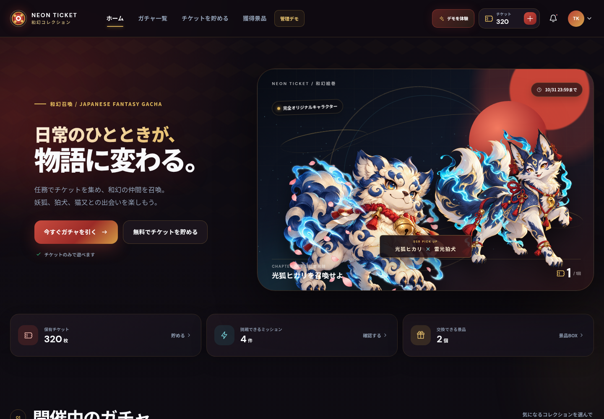
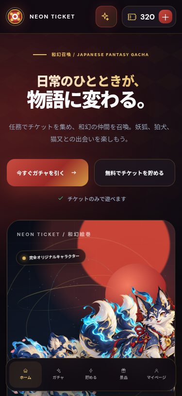
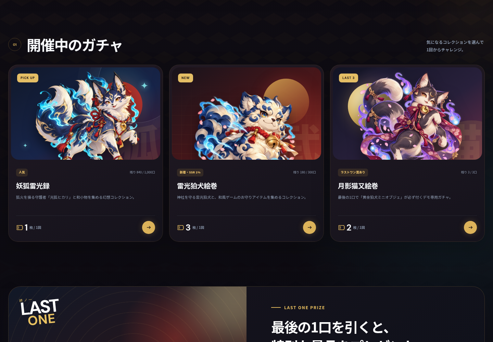

# NEON TICKET — 和幻コレクションWEBガチャ MVP

妖狐・雷光狛犬・猫又が登場する和風ゲーム世界で「チケットを貯める → ガチャを引く → 景品を申請する → 管理画面で確認する」までを約60秒で体験できる、CrowdWorks提案用のレスポンシブデモです。

- 公開デモ：<https://tokimeki-draw-mvp.webnexa3114.chatgpt.site>
- 会員登録・パスワード：不要
- デモ会員：NEONデモさん（`NT-0284`）
- 初期チケット：320枚

景品、会員、確率、取引、住所はすべて架空のサンプルです。

## ローカルで開く

ビルドやパッケージのインストールは不要です。

macOS / Linux：

```bash
cd tokimeki-draw
python3 -m http.server 4173 --directory dist
```

Windows PowerShell：

```powershell
cd tokimeki-draw
py -m http.server 4173 --directory dist
```

ブラウザで <http://localhost:4173> を開きます。終了するときは、起動したターミナルで `Ctrl + C` を押してください。

`dist/index.html` を直接開いても表示できますが、動作確認にはローカルサーバーを推奨します。

## 60秒デモ

画面右上の「デモを体験」からガイドを開始できます。

1. チケット残高を確認する
2. デイリー、広告視聴、またはアンケートでチケットを獲得する
3. クイック体験から10連ガチャを実行する
4. 景品BOXで獲得景品を確認する
5. 「ラストワン」で残り1口を引き、限定ボーナスを獲得する
6. サンプル住所で景品交換・発送を申請する
7. 管理画面で抽選履歴、残数、交換申請を確認する

100連用の状態もクイック体験から準備できます。最初に戻す場合は、ガイドまたはマイページの「デモデータをリセット」を使用してください。

## 画面・機能

| エリア | 主な機能 |
| --- | --- |
| トップ | オリジナル動物キャラクター、チケット残高、3種類の和風ガチャ、残り口数、ラストワン進捗 |
| チケット獲得 | デイリー20枚、広告30枚、3問アンケート50枚、アプリ条件40枚、共通付与履歴 |
| ガチャ | 景品ラインナップ、提供割合、1回・10回・100回、消費確認、抽選演出、結果一覧 |
| ラストワン | 残り3口の専用ガチャ、最後の1口だけ限定景品を一度だけ付与 |
| 景品BOX | 景品名、レア度、獲得日時、交換状態、申請履歴 |
| 景品交換 | 景品選択、発送／チケット交換、住所入力、内容確認、申請完了 |
| 管理デモ | チケット付与、公開停止、抽選履歴、交換・発送ステータス更新、操作ログ |
| デモガイド | 7ステップ案内、10連・100連・ラストワン状態の準備、状態リセット |
| レスポンシブ | 1440px PC、768pxタブレット、375pxスマートフォン、モバイル下部ナビ |

操作状態は `localStorage` に保存され、再読み込み後も保持されます。同一ブラウザの別タブには `BroadcastChannel` と `storage` イベントで変更を反映します。

## デモ実装と本番実装の境界

| 項目 | このデモ | 本番開発で必要なもの |
| --- | --- | --- |
| 会員 | 固定サンプル会員 | 会員登録、認証、パスワード管理、退会処理 |
| データ保存 | ブラウザ内保存 | DB、バックアップ、マイグレーション |
| 抽選 | クライアント内の架空確率で演出前に確定 | サーバー確定、確率・在庫管理、取引台帳 |
| 二重実行対策 | 画面内ロック | 冪等キー、DBトランザクション、排他制御 |
| ミッション | 広告・アンケートの疑似完了 | 広告事業者API、署名付き成果Webhook、不正対策 |
| 景品発送 | 架空住所による申請 | 個人情報保護、倉庫・配送連携、追跡番号 |
| 管理画面 | 認証なしの疑似操作 | 管理者認証、RBAC、監査ログ、承認フロー |
| 複数利用者 | 端末ごとに独立 | サーバー側の同時実行・競合制御 |
| 運用 | 架空の景品・確率 | 規約、表示義務、年齢配慮、法務・セキュリティ確認 |

サーバー側の同時実行安全性や実在広告の成果認証は、実装済みとは表現していません。詳細仕様書の開示後に、チケットの有償性、抽選条件、景品交換条件、外部広告・配送連携を確定する想定です。

## 動作確認

2026年10月14日に、依存パッケージを追加しないChrome DevTools Protocolスモークテストを実行しました。

| 確認項目 | 結果 |
| --- | --- |
| JavaScript構文チェック | PASS |
| 初期表示・景品ラインナップ | PASS |
| ミッション付与・重複防止 | PASS |
| 1回・10回・100回抽選 | PASS |
| 抽選ボタン連打時の二重消費防止 | PASS |
| チケット・在庫不足時の抽選防止 | PASS |
| ラストワン賞の一度だけの付与 | PASS |
| 発送／チケット交換と管理画面反映 | PASS |
| 管理付与・ガチャ公開停止 | PASS |
| 再読み込み後の状態保持・リセット | PASS |
| 375 / 768 / 900 / 1440pxの横あふれ・ナビ切替 | PASS |
| コンソール・ランタイム・主要アセットエラー | PASS |

結果は **56件成功・0件失敗** です。詳細は [QA_REPORT.md](QA_REPORT.md)、再実行コードは [tests/smoke.mjs](tests/smoke.mjs) にあります。

## スクリーンショット

### PC — 1440px



### スマートフォン — 375px



### 和幻ガチャ一覧 — 1440px



## ファイル構成

```text
tokimeki-draw/
├── dist/
│   ├── index.html
│   ├── styles.css
│   ├── app.js
│   ├── favicon.svg
│   └── assets/
│       ├── hikari-kitsune.png
│       ├── raikou-komainu.png
│       └── tsukimi-nekomata.png
├── docs/screenshots/
│   ├── desktop.png
│   ├── gacha.png
│   └── mobile.png
├── tests/
│   ├── smoke.mjs
│   └── capture.mjs
├── QA_REPORT.md
├── .openai/hosting.json
└── README.md
```

## 参考にした公開サービス

- [PACK LAB](https://pack-lab.jp/) — ガチャ選択、残り口数、複数回抽選
- [ポイントタウン](https://www.pointtown.com/gacha) — 条件達成型のチケット獲得導線
- [オリポケ](https://ori-poke.com/) — 獲得景品と発送・交換フロー

機能と情報設計のみを参考にし、ロゴ、画像、キャラクター、固有デザイン、ソースコードは複製していません。光狐ヒカリ、雷光狛犬、月見猫又は、この提案デモのために画像生成で制作した完全オリジナルキャラクターです。既存のアニメ・漫画・ゲーム作品およびキャラクターとは関係ありません。

ヒーロー背景にはThree.jsを任意読み込みし、金色の輪と青い粒子がゆっくり浮遊する演出を追加しています。CDNやWebGLが使えない環境では自動的にCSSデザインへフォールバックします。ボタン選択、キャラクター選択、抽選開始、報酬表示にも低負荷のフィードバックアニメーションを適用しています。
